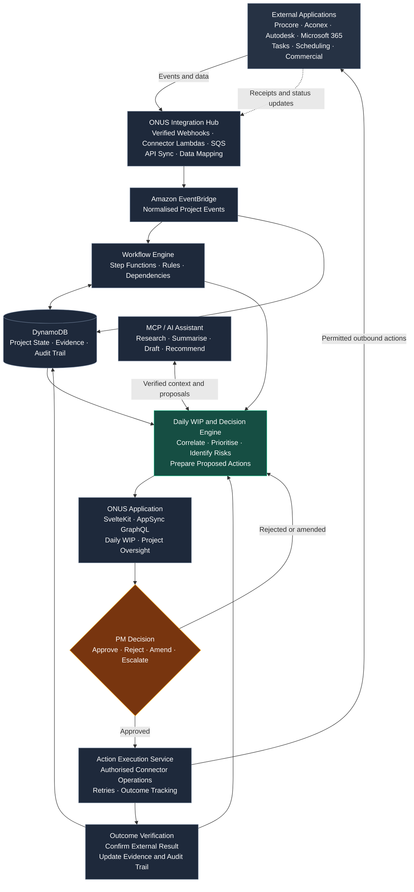

# ONUS RFI — SaaS Architecture

**Status:** Working architecture, updated 15 October 2026. Decisions below describe the intended product; features and integrations described as *proposed* are not yet implemented.

## 1. Product direction and scope

ONUS RFI is an **integration-first, multi-tenant construction workflow and accountability SaaS**. It should provide a project manager with a coherent view of RFIs, documents, approvals, signatures, correspondence, responsibilities, deadlines and evidence, even when those records originate in different external applications.

The goal is **not** to replace every construction application with another large project management suite. ONUS should connect to systems already used by each organisation, synchronise relevant records, recognise important state changes, and surface blockers and next actions with auditable provenance.

An overdue RFI or missing approval does **not** by itself prove actual programme delay or contractual entitlement to an extension of time (EOT). Reports must distinguish measured elapsed time, dependencies, assertions and substantiated impacts.

### Current product decisions

- **One hosted, multi-tenant SaaS product.** Customer-operated Docker installations, per-customer self-hosted editions and a separate Enterprise deployment product are **out of scope** for the current roadmap.
- **Event-driven integrations first.** Prefer authenticated provider webhooks and native event delivery, not blanket periodic polling.
- **Targeted scheduling remains valid.** Use one-off timers for deadlines and limited reconciliation polling for providers without reliable events.
- **MCP is a tool/interface layer**, particularly for intelligent assistants and cross-system lookups. MCP is **not** the durable event bus, job queue, source of truth, or workflow state machine.
- **One real application and one full-screen demo.** The demo uses fictional projects/users and safe simulated integrations, rather than an embedded, scaled-down preview.
- **UI rebuilt in SvelteKit**, initially visually similar to existing ONUS branding. Integrate and repair the developer's existing Svelte component library progressively. Do not inherit the existing site's implementation.


## Architecture at a glance — Daily WIP and approval loop

This GitHub-rendered Mermaid diagram illustrates the **proposed** end-to-end data and action paths. The primary user is the **property developer or client-side project manager**. The Daily WIP is the central experience; RFIs are one of several workstreams.



**Reading the diagram:** External systems send verifiable updates into ONUS. Its event/workflow and evidence services establish the current position, the Daily WIP prepares the next decisions, and the project manager approves or changes proposed actions. Only authorised actions are sent back to external systems; their actual outcomes are checked and recorded. MCP/AI helps interpret and draft, but does not replace reliable execution, permissions or audit records.

**Implementation note:** This diagram is a high-level conceptual view, **not** a literal guarantee of transaction order. External events must be validated and durably handled; project-state changes and their audit/outbox records should be atomic where appropriate. Publishing to EventBridge and running downstream workflows have separate retry and failure handling, as specified below.

## 2. Technology and deployment

| Concern | Direction | Notes |
| --- | --- | --- |
| Application UI | SvelteKit + TypeScript | Customer portal, organisation admin and platform admin |
| UI foundation | Developer's existing Svelte components | Components and theme to be reviewed and fixed during integration |
| Authentication | ONUS first-party authentication (initial flow implemented) | SvelteKit routes use DynamoDB-backed users and sessions; AppSync identity propagation and resolver authorization remain to be implemented |
| Infrastructure | SST on AWS | Existing repository uses SST 4.17.2 |
| Client API | AWS AppSync GraphQL | Queries, mutations and authorised subscriptions |
| Operational data | Amazon DynamoDB | Tenant-aware access patterns, conditional writes and event history |
| Files/evidence | Amazon S3 | Private drawings, signing evidence, exports and attachments |
| Integration ingress | API Gateway + Lambda + SQS (proposed) | Verify, durably enqueue and normalise inbound provider messages |
| Internal event routing | Amazon EventBridge (proposed) | Fan out trusted, normalised domain events |
| Durable workflows | AWS Step Functions (proposed) | Coordinate approval dependencies, retries and external callbacks |
| Timers | EventBridge Scheduler (proposed) | Individual deadline reminders and wake-ups |
| Work execution | AWS Lambda | Connector adapters, rules, verification and report generation |
| Email | Amazon SES | Track distinct send/acceptance, delivery, bounce and complaint outcomes where available |
| Intelligent tool access | ONUS MCP server (proposed) | Read context and request authorised actions through application services |
| Billing | Undecided | Do not assume Stripe or a pricing model yet |

Hosting region, domain split, service quotas, provider choices, retention and commercial terms need confirmation. Domain/subdomain separation alone is **not** a security boundary.

### Application surfaces

1. Public marketing site, pricing and live-demo entry.
2. Authenticated customer workspace: project overview, RFI management, dependencies, evidence, activity and reporting.
3. Organisation administration: members, roles, connected applications, integration health and organisation configuration.
4. Platform administration: tenants, integration diagnostics, support, usage and operational controls.
5. Isolated demo workspace: full application with fictional people, records and deterministic test scenarios.

## 3. Data ownership and domain model

### Primary entities

- `Organisation` (tenant), `User`, `OrganisationMembership`, `Project`, `ProjectMembership`.
- `Rfi`, `Assignment`, `Response`, `Attachment`, `AuditEvent`.
- `IntegrationConnection`: organisation, provider, authorised scope, status, secrets reference and connection owner.
- `ExternalObjectLink`: provider identifier and external object identifier mapped to an ONUS project/document/RFI.
- `NormalisedEvent`: source event, source object, received time, effective time, provenance and processing status.
- `WorkflowDefinition`, `WorkflowRun`, `Task`, `Dependency`, `Notification`.
- `EvidenceReference`: pointer to immutable or revision-controlled source evidence and its integrity metadata, where applicable.

These are **conceptual entities**, not a committed DynamoDB schema. Partition/sort keys and GSIs must follow verified access patterns, including per-project timelines, unresolved items by assignee, status/deadline lists, external-object lookup, deduplication and operational replay.

ONUS is authoritative for its **own** assignments, workflow decisions, audit records and notification outcomes. For imported documents, signatures and external tasks, the provider may remain authoritative. Keep the original provider identifiers, event IDs, source timestamps and evidence references; never silently turn an inference into an externally verified fact.

### Statuses are not interchangeable

- `document.signed`: an applicable party has signed; this may **not** mean all required signatures are complete.
- `document.completed`: the provider says its required document/envelope process is complete.
- `email.accepted` / `email.sent`: a sending service accepted or transmitted a message; this is **not** proof of delivery or reading.
- `email.delivered`: the delivery service reports delivery, **not** proof the recipient read it.
- `approval.completed`: a defined approval process completed under documented project rules.
- `rfi.responded`: a response was submitted; this does not automatically mean the RFI is resolved.

Precisely define these events per connector before relying on them for contractual reporting.

## 4. Integration Hub: how information enters and leaves ONUS

External integrations may include document management, e-signature, email, scheduling, cost/accounting and construction/RFI tools. **No external provider integration is confirmed yet**; the mentioned "PCX" application must be identified and its API/webhook capabilities verified before building a connector.

### Inbound event path

```text
External provider
  -> signed webhook / supported event delivery
  -> API Gateway + provider verification Lambda
  -> SQS ingestion queue (+ dead-letter queue)
  -> connector normaliser/validator
  -> trusted organisation/project/external-object mapping
  -> DynamoDB state transition + append-only event + outbox (atomic)
  -> DynamoDB Stream/outbox dispatcher -> EventBridge
  -> authorised workflow/rule consumers and notifications
  -> AppSync query/subscription -> ONUS interface
```

This is a **proposed reference flow** rather than a claim of deployed resources. Simpler direct resolvers may be appropriate for internal operations, but external event processing must remain reliable and observable.

Ingress should acknowledge a provider **only after** the message is authenticated and durably accepted. Where source evidence is required, retain the raw payload securely with appropriate retention and access restrictions. Assign tenant/project context from the registered integration and verified external-object mapping, **not from an untrusted webhook field**.

Use an outbox/stream dispatch pattern (or equivalent) so a database update cannot silently succeed while the corresponding domain event is lost. A successful EventBridge publish alone does not prove that all downstream consumers ran.

### Canonical event envelope (proposed)

```json
{
  "schemaVersion": 1,
  "eventId": "onus-event-123",
  "eventType": "document.completed",
  "organisationId": "org-demo",
  "projectId": "project-demo",
  "source": {
    "provider": "example-signing-service",
    "connectionId": "connection-demo",
    "eventId": "external-event-456",
    "objectType": "document",
    "objectId": "external-document-789"
  },
  "occurredAt": "2026-10-15T02:00:00Z",
  "observedAt": "2026-10-15T02:00:03Z",
  "correlationId": "workflow-123",
  "evidenceRef": "evidence/demo/123"
}
```

`occurredAt` is a provider claim unless independently verified; `observedAt` is assigned by ONUS. Event IDs and an idempotency key derived from the trusted provider/connection/source-event identifier must support deduplication. Version the canonical schema and allow connectors to evolve independently.

### Connector responsibilities

Each provider adapter should declare:

- **Capabilities:** available queries, supported webhook event types, permitted mutations, relevant record types and API limits.
- **Authentication:** OAuth/service account/API key as supported; consented scopes and credential expiry/rotation.
- **Mapping:** provider objects to organisations/projects/RFIs/documents and canonical ONUS events.
- **Direction:** read/import, outbound action/write, or bidirectional synchronisation.
- **Delivery contract:** webhook retries, ordering limitations, pagination/cursors, rate limits and any polling fallback.
- **Reconciliation:** how to detect missed events and safely recover without duplicate effects.
- **Diagnostics:** last successful event/sync, connection health, retry state and user-visible errors.

Prefer webhooks over periodic API calls when trustworthy webhook delivery exists. Use **targeted, rate-limited polling** only for systems that lack webhooks or for periodic reconciliation. Never treat an API response, inferred status or email send event as evidence for a stronger claim than it supports.

Outbound changes need explicit permissions, a defined source of truth, idempotency keys, retry/backoff behaviour and loop prevention (for example, a change imported from a provider should not be written straight back to it indefinitely).

## 5. Workflow orchestration (not endless cron jobs)

Persistent workflow state should be owned by ONUS services and/or Step Functions, not by an uncontrolled chain of MCP calls.

**Example — a signed document unblocks work:**

1. An ONUS task depends on completion of a particular externally managed document.
2. A verified provider webhook reports signing or completion, including its stable external identifier.
3. The connector maps the external identifier to the correct organisation, project and dependency.
4. A conditional DynamoDB update and immutable audit event record the newly verified state and evidence reference.
5. A workflow evaluates **all** dependency conditions, not just the latest incoming event.
6. If the task is now unblocked, ONUS updates the task, notifies authorised participants and refreshes subscribed dashboards.
7. Failed side effects remain retryable; the event and its provenance remain inspectable.

Use **Step Functions** for long-lived multi-step business processes and wait-for-callback patterns where appropriate. Use **EventBridge Scheduler** for an explicit deadline or delayed reminder, not a blanket scan of every record each minute. Use a limited reconciliation schedule for vendor systems that might miss webhook deliveries.

Assume at-least-once delivery and occasional out-of-order events: consumers must be idempotent, updates conditional, state transitions monotonic or revision-aware, and failure paths routed to retries/dead-letter queues. Provide bounded retry policies, replay tools, alerting and manual repair procedures.

## 6. MCP and intelligent project assistance

MCP helps a host or assistant **discover and invoke authorised tools**. An ONUS MCP server could expose:

- Read-only tools such as `getProjectStatus`, `getOutstandingSignatures`, `listBlockedTasks`, `getRfiHistory`, `findEvidence` and `getIntegrationHealth`.
- Controlled commands such as `draftReminder`, `requestDocumentStatusRefresh` and `proposeAssignment`.
- Explicitly authorised mutation tools, when needed, routed through the **same** domain services and audit path as GraphQL mutations.

The AI/host may coordinate multiple tools (including tools backed by different providers), but **one MCP calling another MCP calling another** is not the reliable event pipeline. Durable workflow orchestration, business rules and source validation remain in application services.

MCP security constraints:

- Authenticate the caller, authorise every tool and resource against the organisation/project and role, and apply least-privilege external scopes.
- Keep provider secrets server-side (Secrets Manager/KMS or equivalent), never in model prompts or browser code.
- Treat external tool responses, documents and natural-language instructions as untrusted data; do not allow prompt injection to override permissions or workflow rules.
- Require the appropriate human approval for sending external messages, altering project records or taking other consequential actions.
- Apply timeouts, rate limits, request budgets, audit correlation IDs and protections against recursive tool invocation.
- Do not allow an agent's assertion to become the factual source of an evidence/audit event without verification.

MCP features are a **later layer over working connectors and verified domain events**, not a prerequisite for integrating the first external system.

## 7. GraphQL application API

AppSync remains the main typed API for SvelteKit; it is not replaced by MCP. Candidate operations (names not final):

| Type | Examples |
| --- | --- |
| Queries | `myOrganisations`, `projects`, `project`, `rfis`, `rfi`, `rfiEvents`, `projectDashboard` |
| Queries — integrations | `integrationConnections`, `integrationHealth`, `projectActivity`, `blockedTasks`, `documentEvidence` |
| Mutations — RFI | `createProject`, `createRfi`, `assignRfi`, `respondToRfi`, `closeRfi`, `reopenRfi` |
| Mutations — integrations | `beginIntegrationConnection`, `disconnectIntegration`, `requestStatusRefresh`, `requestAttachmentUpload` |
| Subscriptions | `onProjectRfiChanged`, `onRfiEventAdded`, `onProjectActivityChanged`, `onIntegrationHealthChanged` |

Authorise every resolver, nested field, subscription and upload/download operation server-side. Authentication alone is insufficient: membership, project access, integration scopes and the actual action must be checked.

## 8. Demo environment

The demo should be the **real full-screen ONUS application**, reached from the public marketing site rather than embedded as a small SPA viewport.

Initial fixtures should include approximately three fictional projects, 20–30 RFIs and four to six role-based fictional users (for example a project manager, architect, contractor and client representative). Users can explore actual workflows, switch simulated identities within the demo's authorised scope, create or answer RFIs, inspect evidence and see outcomes on real dashboards.

Use isolated, short-lived demo organisations or sessions with predictable seed data, reset/expiry and clear demo labelling. **No external emails, billing charges, live vendor mutations or access to customer projects.** Demo connector events must use fixtures/simulators or dedicated provider sandboxes, never production accounts.

These same fixtures should serve automated workflow, integration and UI tests.

## 9. Security, auditability and operations

- **Multi-tenancy:** enforce verified organisation/project membership at every API, consumer, queue handler, event route, storage access and MCP tool; prevent cross-tenant correlation by guessed IDs.
- **Evidence:** append-only event timelines with server observation time, provider time, source identifiers, revisions and pointers to supporting original records.
- **Atomicity:** conditional transactions or equivalent for state + audit/outbox; never report a successful business transition based solely on a queued notification.
- **Credentials:** encrypt per-organisation external secrets, rotate/revoke them and audit who connected each integration.
- **External input:** validate webhook signatures/replay windows, validate schemas, sanitise evidence metadata and enforce payload limits.
- **Reliability:** SQS retries and DLQs; EventBridge failure handling; throttling limits, idempotency and restartable workflows.
- **Observability:** structured logs, correlation IDs, metrics for event lag/dropped events/failed workflows, per-provider health and support tooling for safe replay.
- **Lifecycle:** backups, restore tests, deployment-stage separation, retention/privacy policies and recovery procedures.
- **Programme reporting:** avoid claiming legal causation or EOT entitlement from timestamps or AI summaries alone.

## 10. Testing strategy

Integration quality is central to the product: the UI can be healthy while an external connector silently stops reporting.

| Test layer | Minimum coverage |
| --- | --- |
| Unit/domain | Canonical event mapping, state machine, dependency evaluation, deadline rules and idempotency |
| Connector contract | Fixture payloads, webhook signature verification, schema changes, pagination and outbound action shapes |
| Workflow | Signed vs fully completed, multiple signatures, partial approvals, missing responses, escalation and cancellation |
| Delivery resilience | Duplicate/out-of-order events, transient failures, 429s, expired tokens, SQS retries, DLQ redrive and event replay |
| Security | Cross-tenant/project access, unauthorised subscriptions, attachment URLs, MCP authorisation and webhook spoofing |
| Provider sandbox | End-to-end tests against each vendor's test environment when available; no real customer data |
| UI/e2e | Role-based navigation, RFI creation/assignment/response, realtime updates and evidence timeline |
| Demo safety | Fake-user isolation, automatic reset and proof that no live external side effects occur |
| Operations | Alerting, reconciliation after missing events, backup/restore and simulated provider outages |

For each new connector, define a small **acceptance matrix**: source event, expected canonical state, expected project impact, audit evidence, notification/side effect and failure/retry behaviour. Use recorded provider fixtures and deterministic replay so regressions are reproducible.

Example cases: (a) one signatory completed but others pending → not `document.completed`; (b) SES accepted a message but delivery failed → never mark delivered; (c) the same signed webhook arrives twice → one effective state transition; (d) the final dependency completes → the blocked task becomes eligible to proceed after the configured checks.

## 11. Implementation roadmap

1. **Existing foundation:** root pnpm workspace/lockfile, SST SvelteKit starter, shared types and initial architecture documentation.
2. **Requirements and source systems:** identify the first three real integration providers, including the product tentatively called "PCX"; confirm authentication, APIs, event/webhook availability, read/write rights, sandboxes, lifecycle definitions and data ownership.
3. **Core SaaS:** build on the implemented authentication, project authorisation, DynamoDB project records and workspace UI; add member assignment, integrate the existing component library, and build AppSync and private S3.
4. **Integration vertical slice:** implement one documented external change (for example document signing completion) end to end: webhook → queue → canonical event → reliable state/audit update → workflow → GraphQL UI. Add fixtures, idempotency and replay from day one.
5. **RFI + demo:** implement RFI lifecycle, assignments, responses, evidence and a fully usable seeded demo across roles; verify external side effects stay disabled.
6. **Connector framework:** establish adapter contracts, connection health, reconciliation, retry/observability tooling and the next priority integrations.
7. **MCP/AI assistance:** expose verified read tools and approval-gated actions after the underlying workflows work without AI.
8. **Advanced analysis:** evidence-linked programme impact, scheduling imports, audit exports and EOT-support features after validated requirements.

Do not build separate vendor-specific logic into Svelte components. Prefer shared domain services and connectors that can be exercised by AppSync, background workflows and authorised MCP tools.

## 12. Open decisions

- Which **specific external products** are the first three integrations? What is the full product/vendor name of "PCX"?
- Which systems own document completion, signature status, email delivery, approval, tasks and RFIs?
- Which operations are **read-only** versus allowed to update third-party applications, and who approves outbound writes?
- Which providers support webhooks, sandbox accounts, reconciliation APIs and reliable unique event identifiers?
- What project-level permission roles, retention/evidence rules, hosting region, billing model and support expectations are required?
- What must the project manager see first: overdue RFIs, unsigned documents, pending approvals, unacknowledged correspondence or a combined blocker view?

## 13. Current repository status

- `packages/sveltekit`: branded public/authentication pages, first-party signup, verification, login, logout, password reset, sessions and onboarding; protected Daily WIP shell and private project creation, listing/search, detail, editing, archive and restore.
- `packages/infra`: SST website, authentication DynamoDB/secret resources and a separate linked `OnusProjectsData` DynamoDB table without TTL.
- `packages/shared`: initial framework-neutral types, **not** authorisation/business rules.
- `sst.config.ts`: existing stage-aware SST entry point.
- AppSync and authorization integration with the current session model are not yet implemented.
- Future integration/workflow/MCP package boundaries are **proposals**, not existing files or deployed services.

### Implemented project storage and access

The current project tools use SvelteKit server loads/actions, not AppSync. The server derives the active organisation from the authenticated user rather than trusting a client-supplied organisation ID.

All `/app` routes share a persistent workspace layout: organisation/account sidebar, section navigation, workspace header and content area. Daily WIP and project list/create/detail/edit screens render inside that shell. The active navigation item follows the current route (including nested project routes), and client-side navigation preserves the shell while keeping deep links and browser history working. Project-specific layout styles apply only to the content, not a separate application header.

| Record | Partition key | Sort key |
| --- | --- | --- |
| Project profile | `ORG#<organisationId>#PROJECT#<projectId>` | `PROFILE` |
| Explicit project membership | Same project partition | `MEMBER#<userId>` |
| Per-user project listing reference | `ORG#<organisationId>#USER#<userId>` | `PROJECT#<projectId>` |

Listing follows paginated references and rechecks active project membership and profile for every result with strongly consistent reads. Stale references after access revocation do not expose records. Reads are not a transactional snapshot of the whole portfolio.

Creation requires an active organisation owner, administrator or project manager. A transaction writes the profile, creator's `MANAGER` membership and listing reference while checking the organisation and organisation membership. Editing, archiving and restoring require both that organisation role and an active project `MANAGER` membership. Organisation owners/admins do not bypass explicit project assignment. Assigned `VIEWER` members can read but cannot mutate projects. Member assignment UI and organisation switching remain future work.

Updates transactionally check active organisation/project memberships and the expected profile version. Stale submissions return a conflict instead of overwriting newer changes. Statuses are planning, active, on hold and completed; archive is a separate timestamp. Archive retains current details and membership and blocks edits until restored. Creation/update timestamps and actors are stored, but append-only audit events and revision history are not yet implemented.

The project tests cover persistence, validation, tenant/member isolation, read-only permissions, concurrent updates, archive/restore, revocation and paginated listing against linked development tables. See the [README validation commands](../README.md#project-tools).

See [README](../README.md) for local development conventions. This document is an architecture plan; confirm each service and provider against implemented code before describing it as live.
